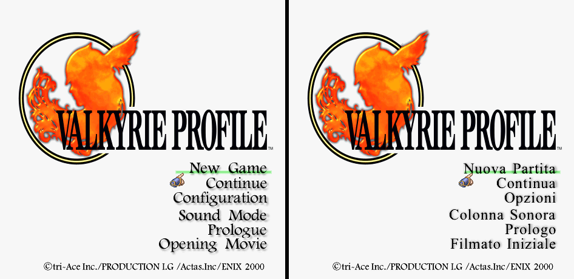

# Valkyrie Profile in Italiano

An Italian fan translation of Valkyrie Profile (PlayStation, USA release, SLUS-01156 / SLUS-01179),
and the tools and notes that made it possible. *Traduzione amatoriale in italiano: i file di
traduzione sono in `edits_it/`.*



The translation is a work in progress: see [`docs/PROGRESS.md`](docs/PROGRESS.md).
This repository holds no game data. To build anything you need your own copy of the game as
BIN/CUE, the Redump dumps of the USA discs.

## What's here

| Where | What |
|---|---|
| [`edits_it/`](edits_it/) | The Italian text, one edit file per scene, menu or battle table. |
| [`docs/GLOSSARY.md`](docs/GLOSSARY.md) | The names, terms and forms of address chosen, and why. |
| [`docs/VALKYRIE_BIN_TABLE.md`](docs/VALKYRIE_BIN_TABLE.md) | How the encrypted table at the start of `VALKYRIE.BIN` lists the game's 4,472 files: where each one is on the disc and how big it is. |
| [`docs/SLZ_COMPRESSION.md`](docs/SLZ_COMPRESSION.md) | How the game's two compression formats (SLZ types 1 and 2) work, with worked examples and a decoder. |
| [`docs/SCENE_TEXT_FORMAT.md`](docs/SCENE_TEXT_FORMAT.md) | How a scene's text is stored: the scene block, records, text commands and per-scene fonts, with one line taken apart byte by byte. |
| [`docs/FONTS_AND_GLYPHS.md`](docs/FONTS_AND_GLYPHS.md) | The game's many small fonts (scene, menu, battle, italic titles, title-screen pictures), how a byte becomes a letter, and how accented letters are added. |
| [`docs/EVENT_SCRIPT.md`](docs/EVENT_SCRIPT.md) | The program in every scene that runs its events: the virtual machine, its instructions and built-ins, the story counters, and the game's first line traced through the code. |
| [`docs/VP_DIALOGUE_LOAD_PATH.md`](docs/VP_DIALOGUE_LOAD_PATH.md) | The main write-up: how the game finds, decompresses, decodes and draws its text, from disc sector to message box, and everything learned while changing it. |
| [`docs/VP_DIALOGUE_FORMAT.md`](docs/VP_DIALOGUE_FORMAT.md), [`docs/DIALOGUE_SEARCH.md`](docs/DIALOGUE_SEARCH.md) | The earlier notes: the archive, its encryption and compression, and the search for the dialogue. They mention exploration tools that aren't in this repository. |
| [`docs/notes/`](docs/notes/) | Shorter notes (scene package parts, the script's built-in commands, voice clips, sound labels) and the screenshots taken to check each change in the game. |
| `vp_*.py` | The tools (Python 3, no dependencies). |

The tools:

| Script | Does |
|---|---|
| `vp_text_editor.py` | Exports text to edit files and builds edited discs. Everything else builds on it. |
| `vp_text_gui.py` | A browser editor with a preview of each message box. |
| `vp_release.py` | Makes the xdelta and PPF patches for both discs. |
| `vp_progress.py` | Writes the progress table. |
| `vp_scene_text.py`, `vp_scenes.py`, `vp_script.py`, `vp_slz.py`, `vp_disc.py` | Read the disc, the archive, its compression, the scene scripts and their text. |
| `vp_menu_text.py`, `vp_battle_text.py`, `vp_worldmap_text.py`, `vp_title_menu.py` | The menu, battle, world-map and title-screen text. |
| `vp_accents.py`, `vp_glyph_names.py` | The accented letters, and the table of the font's characters. |
| `vp_box_skin.py` | Cuts the message-box artwork for the GUI's preview out of a screenshot. |

## Building the Italian discs

```bash
python3 vp_release.py --disc1 "Valkyrie Profile (USA) (Disc 1).cue" \
    --disc2 "Valkyrie Profile (USA) (Disc 2).cue" \
    --edits edits_it --name "Valkyrie Profile (Italiano)" --version 0.1 --keep-work -o release/
```

This builds both discs from the edit files and writes xdelta and PPF patches with a README of
hashes. `--keep-work` keeps the patched images in `release/work/`. The first run reads every scene
font on the disc to build `vp_glyph_db.json`, which takes a minute.

To build one disc directly:

```bash
python3 vp_text_editor.py build DISC.cue edits_it/*.txt -o OUT.cue --fit-boxes
```

The title-screen labels are drawn as pictures and are re-rendered with a small Swift program
(`tools/render.swift`), so building `title_menu.txt` needs macOS with `swiftc`.

## Editing

```bash
python3 vp_text_editor.py export DISC.cue --scene 0x16 -o scene_0x16.txt
python3 vp_text_gui.py DISC.cue --edits edits_it
```

`export` writes a scene's English text as an edit file. `--menu`, `--battle`, `--worldmap`,
`--system` and `--title` do the same for the other kinds of text. The GUI at
http://127.0.0.1:8766/ edits scenes and tables with a preview of each message box. It shows each
scene's place names if `vp_scene_map.json` exists, made with
`python3 vp_scenes.py VALKYRIE.BIN --json vp_scene_map.json` from the disc's `VALKYRIE.BIN`.
`python3 vp_progress.py DISC1.cue --edits edits_it -o docs/PROGRESS.md` updates the progress
table.

## What isn't here

The game's executable, the disassembly, the text dumps, the disc images and the patched images
stay out, and so does the font. The tools find each character by its glyph bitmap, and
`vp_glyph_names.json` keys that table by a hash of each bitmap, not by the bitmap itself.

The notes mention TinyPSX, the PlayStation emulator the game was traced in. It isn't part of this
repository.

## License

* **The translation and the documents** (`edits_it/` and `docs/`) are under
  [CC BY-NC-SA 4.0](LICENSE-text): share and adapt them for non-commercial use, with credit, under
  the same license.
* **Everything else** (the tools and the data files they read) is under the [MIT License](LICENSE).

Valkyrie Profile, its text, names and characters belong to their rights holders. Neither license
covers them.
