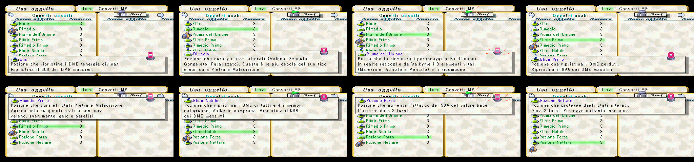
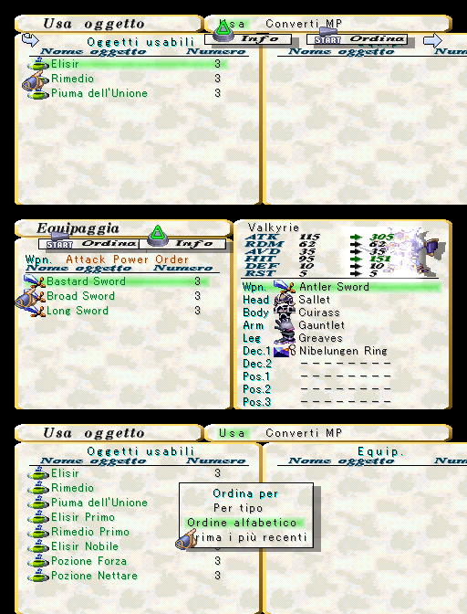
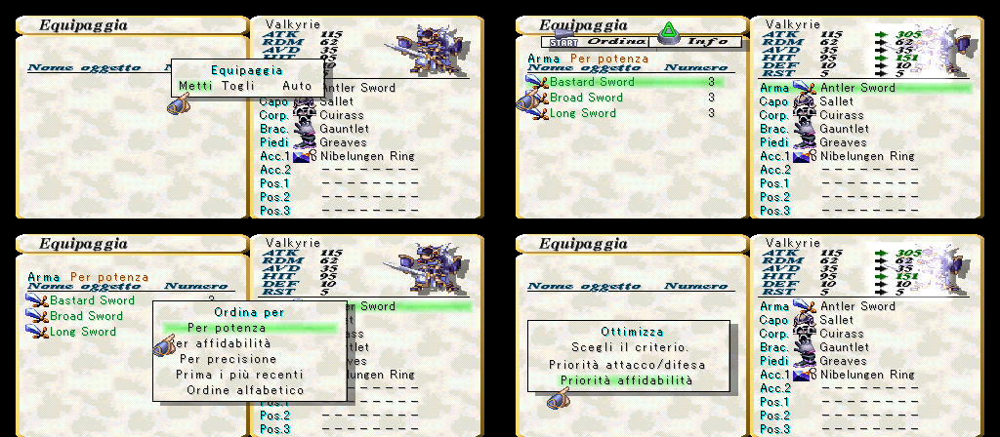
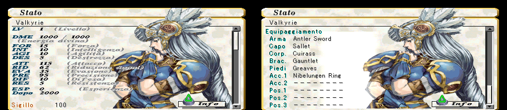
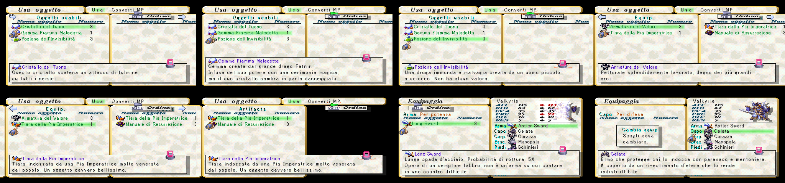
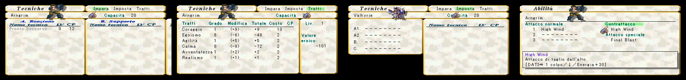

# Menu and battle text

Not all of Valkyrie Profile's text is scene dialogue. Item names and their help lines, the camp menu,
skill names, the save screen, the battle menu, monster names and Lenneth's hints in battle are kept
somewhere else: in **string tables**, each loaded with its own menu or battle screen. This document
explains those tables, how their text is encoded, and how the translation edits them.

The counts below were checked on disc 1. Dialogue is in `docs/SCENE_TEXT_FORMAT.md`, and the fonts
in `docs/FONTS_AND_GLYPHS.md`.

## The tables

There are 17 tables. A scan of every file that isn't a scene found exactly these.

**13 menu tables, 10,674 strings:**

| file | screen | strings |
|---:|---|---:|
| 6 | title screen and New Game menu (also song titles and character names) | 305 |
| 2175 | camp menu, top level | 64 |
| 2176 | camp menu: Skill | 1,506 |
| 2177 | Transfer | 926 |
| 2178 | Ability | 232 |
| 2179 | Use Item | 2,278 |
| 2180 | Divine Item | 1,893 |
| 2181 | Status | 1,026 |
| 2182 | Party | 947 |
| 2183 | Equipment | 1,329 |
| 2184 | Configure | 40 |
| 2185 | Data (save and load) | 87 |
| 4734 | world map (controls, place names) | 41 |

**4 battle tables, 1,848 strings:**

| table | contents | strings |
|---|---|---:|
| 1500.7 | battle menu, elements, skill and attack names | 333 |
| 1500.9 | character and monster names | 321 |
| 1806.1 | item, equipment and spell names and help lines | 1,080 |
| 1988.2 | battle dialogue: Lenneth's tactical hints, boss lines | 114 |

A battle table is named by its file and part: `1806.1` is part 1 of file 1806. File 1501 holds an
identical copy of both 1500 tables.

## Where they sit

**Menu packages.** Files 2175 to 2185 each have three parts:

* the sub-menu's code (type 18);
* the string table (type 4);
* its font (type 7).

File 6 is the title screen's 52-part package, with the table and font among its parts. In file 4734
the font is the second stream of the text part.

**Battle files** use a different package layout: a count, a 0, then a (flags, size) pair for each
part, then the parts. The table and its font are two neighbouring parts, each a one-stream SLZ
container.

The tables are compressed with SLZ (`docs/SLZ_COMPRESSION.md`). Among the menu tables, the six
smallest use type 2 and the rest type 1.

## The table layout

Menu and battle tables share one layout:

```
u32 text_offset            = 4 + 8 × n
n × (u32 id, u32 offset)   message id, and where its string starts, counted from text_offset
strings                    each ending with a 0 byte
```

* **Ids belong to a screen.** `0x64` is "New Game" in the title table, and a place name in the world
  map table. The camp sub-menus share most ids: 2,412 ids appear in more than one table, and an item
  keeps its id in every table that names it.
* **Order:** the ids are in ascending order, except in tables 2179 and 2180. There, the strings `[`
  and `]` (ids `0x1A8E` and `0x1A8F`) are listed twice. The tools keep every table's order as it is.
* **No sharing:** no two entries point at the same bytes, and none points into the middle of a
  string.

## Encoding: menus

Menu text is one byte per character, close to ASCII:

| bytes | meaning |
|---|---|
| `01`-`5F` | the ASCII characters `0x20`-`0x7E`: the byte plus `0x1F`. "Skill" is `34 4C 4A 4D 4D`. |
| `80` | line break |
| `81 80 nn` | colour `nn` for what follows: 07 the blue labels (LV, DME), 02 red ("Empty"), 01 orange, 03 black |
| `60`-`7F`, `81`-`85` | extra glyphs: icons, rules and the strips in skill help. They differ between menus. `81` is a glyph whenever the next byte isn't `80`. |

The colour code appears 478 times, mostly as colour 7. The byte `81` also appears 85 times as a glyph: in the Use Item
table's font, glyph `0x81` is a tall closing bracket, 6 pixels wide. Followed by a space (`01`), it ends
the stat lines in skill help. The encoding was first misread as "Scheme A",
which subtracted 1 above `0x40` and read lower case as upper case.

## Encoding: battle text

The battle tables use the same layout, and `80` is still a line break. But each byte is a glyph number
in that table's own font, numbered in order of first use, like a scene font. The item table's font
starts with E, l, i, x, r, from "Elixir". This is why early work saw the item table as "binary data,
not readable text".

To read it, the tools match each battle glyph's bitmap against the menu fonts, which use the same
typeface:

* **Named glyphs:** every glyph of the names table matches. The other tables have a few that don't:
  Japanese placeholders (空欄 "blank", 予約 "reserved", 未定 "undecided") and symbols.
* **Symbols:** four battle-only symbols are named by hand, `…`, `「`, `·` and `’`. The rest are kept as
  raw codes.
* **Padding:** each font ends with blank glyphs of width 0 that only make the count even.

## How the game loads them

* **A heap block per table:** each table, and each font, is decompressed into a heap block of its own
  size. A longer table just gets a bigger block. In a camp-menu memory dump, table 2175 is at
  `0x80102BC4`. Mid-battle, the 1806 item table is at `0x801197DC`, with 720 KB of heap free.
* **The disc is the limit:** a file can't outgrow its sectors (`docs/VALKYRIE_BIN_TABLE.md`). After
  the tools re-compress, the English menu files have room for 92 bytes (Configure) up to 2.6 KB
  (Divine Item) more of compressed text. The battle files have 0.7 KB (1988) to 2.1 KB (1501). Text
  compresses about 2:1. With every item name and help line in Italian, the camp tables still have
  0.5 to 2.1 KB of room, and the item file 1806 1 KB.

## Editing them

```bash
python3 vp_text_editor.py menus  DISC.cue                         # list the 13 menu tables
python3 vp_text_editor.py export DISC.cue --menu 2175 -o menu_2175.txt
python3 vp_text_editor.py export DISC.cue --battle 1806.1 -o battle_1806.1.txt
python3 vp_text_editor.py build  DISC.cue edits_it/*.txt -o OUT.cue
```

An edit file lists messages by id. From `edits_it/menu_2175.txt`:

```
@@ 0x0005
Abilità
```

* **Text:** a line break is a real line break, and `{81 80 07}` is raw bytes in hex (a colour, an icon).
* **Linked copies:** `build` also changes every other table that has the same id with the same
  original text. Renaming an item in one table renames it in the battle table and every camp
  sub-menu. 662 of the battle item table's strings are also in the camp menus. `--no-link` turns this
  off.
* **Two sets of help lines:** the item help lines in the camp menus (Skill, Use Item, Divine Item and
  Equipment share them) are longer than the battle ones. 263 of the 444 differ in their English, so
  linking can't carry them over, and both sets have to be translated. The camp help box fits lines up
  to the widest English one, 326 pixels, on three lines.
* **Rebuilding:** a table with no edits keeps its bytes. An edited table is written again: the index,
  then every string in table order, the order the disc stores them in. The first tools wrote a
  longer string after the last one and zeroed its old place; once all 612 item help lines were
  translated, that layout made the Skill table 12 KB too big for its sectors, and the item file 8 KB.
* **Width:** menu text is drawn at fixed places, so a longer label can run into the next one. `build`
  warns when an edit makes a string wider than the original, measured with the font's widths.
  `docs/GLOSSARY.md` lists the lines shortened for this.
* **New letters:** a menu font can't grow, so an accented letter replaces one of ten characters the
  menus never show. A battle font gains a glyph over its blank padding, up to 127 glyphs.
  `docs/FONTS_AND_GLYPHS.md` explains both.
* **Checks:** `check --menus` decodes and re-encodes all 10,674 menu and 1,848 battle strings, and
  rebuilds every table and font byte for byte.

## Checked on screen



The camp menu's Use Item screen, on the Italian disc, with eight items granted by the script (built-in
`E6`). Triangle ("Topic") shows each item's help line. The item names, the headers and all eight help
lines are Italian, and none runs out of its box.



The tabs above the list are "Info" (Topic, string `0xD5`) and "Ordina" (Sort, `0x32`, on Start). Start
opens the Sort menu, strings `0x33` to `0x37`. Top to bottom: Use Item, Equipment, and the Sort menu.



The Equipment screen (table 2183): the action popup, the weapon list with both tabs, the Sort menu
and the Ottimizza (best equipment) screen, with three weapons granted by the script. Its 67 interface
strings are Italian. The weapon and armour names
and their help lines are item text, translated since (next section). The slot names (Arma, Capo, Corp. …) are shared with the
Status screen through the link, and fit there too.



The Status screen (table 2181): 55 interface strings, with the stat abbreviations, which also
change on the Equipment and Party screens. Its labels and explanations use the small italic font
(`docs/FONTS_AND_GLYPHS.md`), which had no accented letters until the build drew them in. The
profile fields (Classe, Razza, Età, Rimpianti …) only show for recruited heroes, and were checked
by reading the disc back. The characters' biographies (Triangle) and the skill names are still in
English.

## The camp menu's tabs

A tab draws its label in a large italic, about 1.8 times the label's width in the menu font. So
"Ordina" ran past the right edge of the Sort tab, though `build` measured it only 12 pixels wider
than "Sort". The tab can be made wider instead.

**Layout records.** The camp menu program (file 2174, one SLZ block loaded at `0x8002F824`) draws
some of its screen from lists of 20-byte records, each list ended by a record starting with `FF`:

| bytes | meaning |
|---|---|
| 0 | type: 2 text, 5 button icon, 7 box (then `08 00 00`) |
| 4-7 | the text's message id, or the icon number |
| 12-15 | x and y, relative to where the screen places the list |
| 16-19 | width and height (a box) |

Each of the two tabs is one such list:

| tab | label | icon | box |
|---|---|---|---|
| Topic | message `0xD5` at x 40 | 8 (Triangle) at x 9 | 96 × 12 |
| Sort | message `0x32` at x 48 | 4 (Start) at x 9 | 96 × 12 |

The box function (`0x8004081C`) draws the outline, the background and both shadows from the box's
width, so changing that one number widens the whole tab. The screen chooses where the list goes:
Use Item puts the Sort tab at (336, 37) with an arrow at x 465, and Equipment puts it at x 42, just
left of the Info tab at x 152.

**`camp_tabs.txt`.** `vp_text_editor.py export DISC.cue --camp-tabs` writes the two widths, and
`build` writes a changed width into file 2174 and compresses it again in place:

```
@@ 0x32 Sort (Start, label at x 48)
width 111
```

At 111 pixels the Sort tab's right edge falls on the Info tab's left edge in Equipment, so the two
share one border line. "Ordina" needs about 108. Any wider and the tabs overlap. Divine Item also shows a Sort tab, presumably from the same
record, since the program has only one. It couldn't be opened this early in a test game, so it
hasn't been seen.

## Item names

The policy follows the official Italian Final Fantasy VIII: everything you use up, craft with, wear or
carry gets an Italian name, and every weapon keeps its English name (`docs/GLOSSARY.md`, "Item
names"). 258 names are Italian and 196 stay English; the 32 skill books carry their skill's name,
Italian for 17 of them (next section). All 612 camp help lines and the battle ones are Italian.



Use Item, Equipment and Equipment's weapon list on the Italian disc, with items granted by the
script. Top: the help lines of Cristallo del Tuono, Gemma Fiamma Maledetta, Pozione
dell'Invisibilità and Armatura del Valore. Bottom: Tiara della Pia Imperatrice (the Equip. page and
the Artifacts page), Long Sword (a weapon, so English) and Celata on Valkyrie's head. The longest
Italian names are 136 pixels; the list leaves room for the 155 of the longest English weapon.

**Where a name appears.** An item `n` (the number the script's grant op `E6` takes) has its name at
message `2000 + n` and its help line at `3000 + n`:

* **Table 1806.1** (battle) and the nine camp sub-menus: the names, by the link. The battle copy of
  the help lines is shorter: 263 of them have English of their own, and the rest are copies.
* **Table 1500.7,** messages `0x12D` to `0x133`: the seven healing items' names again, shown when one
  is used in battle. They have no link, so `battle_1500.7.txt` lists them.
* **Scenes:** 248 "Hai trovato …" lines, the 60 choices of the moon-stone puzzle and a few sentences
  name items, so the dialogue changes with the tables. The quest items that appear only in dialogue
  (the elf's four ingredients, the moon stones) follow the same rule.
* **Not used:** Use Item and Divine Item (2179, 2180) also hold a second list of short names,
  `0x1A8E` on (`Prime-Elixir`, `Silver-Sallet`, `Conversion-Gem` …). No camp program loads a message
  id near it: the code only adds item numbers to `0x7D0` and `0xBB8`. It is left in English.

## Skills and abilities

The same rule as for items (`docs/GLOSSARY.md`, "Skills and abilities"): skills that say what they do
are Italian, named techniques, attacks and spells stay English.



Left to right: Arngrim's Learn tab (Pronto Soccorso), his Traits tab, Valkyrie's Set Up tab and
Arngrim's Ability menu with the description of High Wind and its DATA strip.

* **Skill names,** `0x400`-`0x42E`: in the Skill table and, by the link, in Transfer, Use Item, Status,
  Party and battle table 1500.7. The battle copy of Leadership is spelled "Leader Ship", so
  `battle_1500.7.txt` lists it.
* **Skill help lines,** `0x44C`-`0x47A`, and the **traits,** `0x514`-`0x571`: only in the Skill table.
  Battle table 1500.7 uses `0x514` on for enemy attacks, a different text, so no link reaches it.
* **Ability table 2178:** each attack is a pair of messages, its name (even id) and a description
  (odd id) whose second line is the DATA strip, drawn with the table's own glyphs `{62}`-`{6B}`.
  The spell names (`0x1770` on) and help lines (`0x1838` on) are also in Use Item.
* **Battle table 1500.7:** the characters' special attacks (`0x200`-`0x218`), the spells (`0x384`) and
  Great Magic (`0x3B6`) are listed unchanged, so they count as done; the enemy attacks (`0x514` on)
  wait for the monster names.
* **Seeing a recruit's screens:** a new game has only Valkyrie, a goddess with no traits. For the
  check above, Arngrim was put in the party by script: the roster (the pointer at `0x8007F1E4`,
  25 records of 236 bytes, Arngrim the third) marks a member in an active slot with byte +217 = 2, and
  the party slots are the bytes at ctx + `0x39C` (`0x801F6278`), each a roster index + 1.

## Not known yet

* **The battle item list on screen:** in the TinyPSX emulator, choosing Use Item in a battle started
  by a script freezes the game, on the English disc as well. So the battle versions of the item
  names and help lines were only checked by reading the disc back. The camp menu shows the same item
  names, and its own help lines, on screen (`notes/edit_proof/italian_camp_items.png`).
* **What triggers a battle hint:** the hints (table 1988) are loaded only when a battle needs one.
  None of the encounters `0x3FF` to `0x40F`, the battle tutorial's, loads it.
