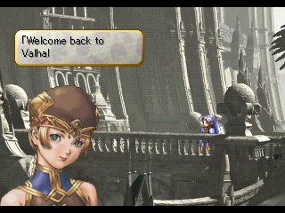
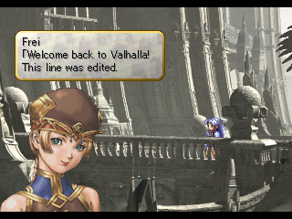

# The message box

Every line of dialogue appears in a parchment box with a gold frame. This document explains how the
script opens that box, how the game decides its size and position, how it lays out and draws the
text, and how the translation makes room for longer Italian lines.

It was traced to make the editor's preview match the game, and checked against emulator screenshots
pixel by pixel. The counts are from disc 1. How a line is stored is in `docs/SCENE_TEXT_FORMAT.md`,
and the script side in `docs/EVENT_SCRIPT.md`.




*Frei's first line in Valhalla, edited to be longer. Top: in its original box the text wraps after
"to", and the box scrolls through it a line at a time. Bottom: with `--fit-boxes` the box is widened
and the whole line shows at once.*

## Opening a box

The scene script pushes six values and calls a library function. The usual one is `func_03e2`:

```
push x, y, width, height, record, wait
call func_03e2
```

`func_03e2` opens the box through `func_033c`, waits until the player dismisses it, then waits the
given number of frames. Inside, the message instruction (op `92`) stores x, y, width and height in the
box. On disc 1 there are 3,417 such calls with all six values written as plain numbers:

| function | calls |
|---|---:|
| `func_03e2` | 3,029 |
| `func_033c` | 242 |
| `func_03f5` | 144 |
| `func_0408` | 2 |

## Position

Small x and y values aren't positions but anchors:

| x pushed | x used | uses |
|---|---|---:|
| 0 | 24 (left) | 869 |
| 1 | 296 − width (right) | 846 |
| 2 | 24 (left) | 58 |
| 3 | 296 − width (right) | 47 |
| 4 | 160 − width / 2 (centred) | 1,460 |
| 8-15 | next to an actor, from that actor's properties | 44 |
| anything else | as pushed | 93 |

| y pushed | y used |
|---|---|
| 2 | 16 (top) |
| 3 | 192 − height (bottom) |
| 4 | 120 − height / 2 (centred) |
| anything else | as pushed |

The screen is 320 pixels wide. On screen, the frame's outline runs from x − 8 to x + width + 9, and
from y + 1 to y + height + 14. The text starts at (x, y + 8).

Anchors 0 and 2 both put the box on the left, and 1 and 3 both on the right. They differ in which side
a portrait goes by default, below.

## Laying out the text

The layout code (`0x80052C3C`, with `0x8004DEE4` for the rest of a word) works one glyph at a time:

* **Advance:** a glyph moves the pen right by its width from the font, times the horizontal scale
  (`<7>`). The space, code `0x31` in every scene font, is 4 pixels wide.
* **Wrapping:** at each glyph, the game measures the line up to the end of the current word. The word
  stays on the line only if that is **less than** the box width. Equal isn't enough. Across the 3,417
  calls, no English line is exactly as wide as its box, and 45 are one pixel narrower.
* **A space after a wrap:** a space that lands at the start of a wrapped line isn't drawn.
* **Line height:** 12 pixels times the vertical scale (`<8>`), plus 2. So a normal line is 14 pixels.
* **Scrolling:** text taller than the box scrolls it up a line at a time.

The original game relies on both: 37 English lines are wider than their box and wrap, and 233 boxes
are shorter than their text and scroll.

## Drawing the text

The drawing code (`0x80052480`) turns each glyph into a small sprite:

* **A cell per glyph:** the glyph is copied into a 16 × 14 cell of 4-bit pixels. Its pixels get one
  colour, and a **shadow** one pixel right and one down gets another. Where the shadow falls on the
  glyph's own pixels, the glyph stays on top.
* **Drawing order:** the cells are drawn through the console's ordering table, so later glyphs are
  drawn first. An earlier glyph's shadow therefore falls over the next glyph: the `T` of "This" shades
  the top of the `h`.
* **Colours:** `<4:nn>` picks one of four pairs, measured from the screen:

| command | glyph | shadow |
|---|---|---|
| `<4:00>` | (16, 16, 16), near black | (140, 140, 140) |
| `<4:01>` | (115, 41, 0), brown | (189, 148, 99) |
| `<4:02>` | (107, 0, 0), red | (189, 140, 140) |
| `<4:03>` | (0, 123, 57), green | (115, 173, 132) |

* **Scaled glyphs:** with `<7>` or `<8>` the game stretches the glyph sprite. Its sampling repeats
  source columns unevenly, so a preview can only come close.

## The box itself

* **The fill:** opaque parchment. Under the top bevel it shades from about (226, 222, 209) to about
  (176, 172, 163) at the bottom, and the shading stretches with the box's height.
* **The frame:** a dark (90, 66, 8) outline around a 2-pixel gold bevel, with chamfered corners.

`vp_box_skin.py` cuts this artwork out of a screenshot for the editor's preview.

## Portraits

A speaker's portrait appears beside the box only when the text asks for it:

* **Queueing:** the script loads a portrait before the line, or the text queues one with `<6:nnnn>`.
* **Showing:** `<19:0100>` shows it at the bottom left, facing right, and `<19:0000>` at the bottom
  right, mirrored. With no `<19>` there's no portrait, even if one was queued.
* **The default side:** `<19:ffff>` puts the portrait on the box's own side. The library sets that
  side (built-in `E0`) from the x anchor: left for anchors 0 and 3, right for 1 and 2.

## Other kinds of box

The same box shows other things through other instructions: a **choice** (op `93`, with `9D` waiting
for the answer), two other box styles (ops `94` and `98`), and **captions** such as place names (ops
`CB` and `97`). The system messages use fixed boxes of these kinds (`docs/SYSTEM_MESSAGES.md`).

## Making room for Italian

Italian lines are often longer than the English. Because the six box values are plain pushed numbers,
`vp_text_editor.py build --fit-boxes` can change them:

* **Measuring:** for each edited record, it measures the widest line and the tallest page, the way
  the layout code does.
* **Growing:** where the text doesn't fit, it rewrites the pushed width as the text width plus 6
  pixels (for the strict wrap test), and the height as the text height. It warns if the box would
  run off the screen.
* **Unchecked boxes:** a call whose values aren't all plain numbers can't be checked. The build lists
  those records, and they're measured by hand.
* **Boxes next to an actor:** for x 8 to 15 the build can't tell where the box will be, so it notes
  that a grown box should be checked in the game. When the English text was already taller than
  such a box and scrolled, the build keeps the box's height, so it scrolls the same way instead of
  growing toward the screen's edge (the knight's armour tips, scene 0x5F #17).
* **Boxes that would leave the screen:** the same rule applies to any box whose English scrolled
  and whose grown height would end below y = 232 (`SCREEN_H - BOTTOM_MARGIN`). The Sprite's lesson
  on gems in the Artolian Mountain Ruins (scene 0x7D #30) is 17 lines in a 98-pixel box at y = 4
  in both languages: grown, it would end at y = 242, so it keeps its height and scrolls.
* **Fixed boxes:** system messages and boxes opened by the engine itself can't grow, so their lines
  are shortened instead (`docs/GLOSSARY.md`).

The game's own widest boxes are 288 pixels. The editor's preview draws each box with the same
layout, glyphs, shadows and colours, and matched the emulator pixel for pixel on the lines tested.

## Not known yet

* **Actor anchors:** how x values 8 to 15 turn an actor's properties into a position.
* **A double-height line in a small box:** a box with no room for a 26-pixel line hasn't come up in
  a test.
