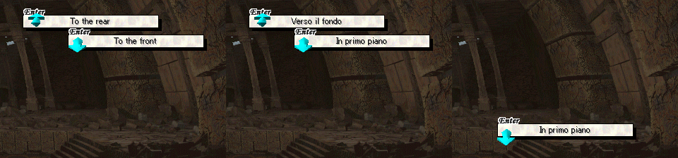

# System messages

A handful of messages can appear in any scene: "The item has broken.", the Artifact prompts, "Exit to
World Map?", "Battle". They aren't stored once. Every scene carries its own copy, as its first 14 text
records. This document explains these **system messages**, where the game shows them, and why
translating them changes every scene on the disc.

Checked on both discs: records 0-13 are the same, byte for byte, in all 1,118 scenes of disc 1 and
all 1,013 of disc 2.

## The 14 records

| record | text | shown |
|---:|---|---|
| 0 | `--` | never |
| 1 | `0123456789!O123456789—!…` | never |
| 2 | The item has broken. | by the field engine |
| 3 | ▼Caution!!▼ This item is an "Artifact". All Artifacts are the rightful property of Lord Odin… | by the field engine |
| 4 | Will you offer up the artifact to Lord Odin? ・Yes ・No | by the field engine |
| 5 | The Artifact has been sent to Valhalla. Evaluation Level +1. You earned N Event EXP. | by the field engine |
| 6 | You gained an Artifact. Evaluation Level -5. You earned N Event EXP. | by the field engine |
| 7 | You can't hold any more items. | probably by the field engine |
| 8 | You earned N Event EXP. | by the script library |
| 9, 10 | To the rear / To the front | by the script library, while the player stands at a door |
| 11 | Exit to World Map? ・Yes ・No | by the script library |
| 12 | Scenario Error 1 | by the script library, a debug message |
| 13 | Battle | by the script library |

"N" is `<14:..>`, which inserts a number (`docs/SCENE_TEXT_FORMAT.md`).

**Why every scene has them.** A scene's font holds only the glyphs its records use, numbered in order
of first use (`docs/FONTS_AND_GLYPHS.md`). The system records come first, so their 96 glyphs are in
every font with the same codes. Records 0 and 1 are never shown. Record 1, a line of digits in two
styles, is probably there so that every font has the digits a `<14>` number needs.

## Where they're shown, and their boxes

Unlike dialogue, none of these boxes grows with its text. Each is opened with a fixed size, so a
translated line has to fit the English box.

**From the script library** (the shared first part of every scene's script, `docs/EVENT_SCRIPT.md`):

| record | where | box |
|---:|---|---|
| 8 | `func_0029`, message op `92` with pushed values | 240 × 12 |
| 9, 10 | `func_0059`, caption op `98` | 192 × 14 |
| 11 | `func_00AF`, choice op `93` | 140 × 46 |
| 12 | message op `92` with inline values | 168 × 42 |
| 13 | `func_03e2(4, 4, 96, 14, 13, 0)` | 96 × 14, centred on the screen |

**From the field engine** (the game's own code, through `show_system_message(record, x, y, width,
height)` at `0x80060948`):

| record | call at | box |
|---:|---|---|
| 2 | `0x800661F8` | 280 × 12 |
| 3 | `0x8006004C` | 236 × 70 |
| 4 | `0x80060094` | 172 × 56 |
| 5 | `0x800604CC` | 224 × 42 |
| 6 | `0x800601F4` | 204 × 42 |

Record 7 probably comes through the treasure code at `0x8005FAB4`, which shows "You found …" lines
in a 280 × 12 box. A line wraps when it reaches its box's width, and a box with no room for another
line scrolls, so a translation must keep each line narrower than these widths. A `<14>` number takes
about 35 pixels.

### "To the rear" and "To the front"



These two are hints shown while the player stands at a door, mostly in dungeons. Each is a bar with
an "Enter" label and a D-pad arrow, telling the player where the door leads. A door is a trigger zone
(built-in `80`, `register_trigger_zone`) whose handler runs again and again while the player is in
it. The handler tests the D-pad: if the button is pressed it changes the room, otherwise it calls
`func_0059` to show the hint. One call shows it only for a moment, so it stays up only while the
calls go on:

* **`func_0059(1)`** shows "To the rear", with an Up arrow. All 219 such calls come right after a
  test of controller bit `0x1000`, Up.
* **`func_0059(2)`** shows "To the front", with a Down arrow. All 209 come right after a test of bit
  `0x4000`, Down.
* **`func_0059(3)`** shows both, stacked, at (32, 24) and (96, 52): a door that leads both ways. It's
  used 29 times.

So "To the rear" means going into the background (Up at a door), and "To the front" coming back
toward the camera (Down). A single hint goes at x 64, at the top of the screen (y 32) when the
player's actor property `0x33` is above 140, otherwise near the bottom (y 178).

**Room.** The text is centred (`<5>`) in a 192-pixel box, and the arrow takes the box's left end, so a
line up to about 130 pixels fits. The English hints are 57 and 61 pixels.

## Translating them: `system.txt`

The messages are edited once, in one file, not 1,118 times:

```bash
python3 vp_text_editor.py export DISC.cue --system -o system.txt
```

The file starts with `# Valkyrie Profile system messages` and lists each record with its box width.
The text is written as in a scene edit file. From `edits_it/system.txt`:

```
@@ 11
Tornare alla mappa?
・Sì
・No
```

`build`, `vp_release.py` and the GUI write each message into every scene whose records 0-13 are the
original ones, adding any glyph a scene's font lacks (such as `è`). A scene edit file that also lists
one of these records wins for that scene.

The Italian file translates records 2 to 11 and 13. It keeps "Scenario Error 1", a debug message, in
English, and leaves records 0 and 1 alone. One line was shortened to fit its box:
"Tornare alla mappa del mondo?" became "Tornare alla mappa?" (140 pixels). "To the rear" and "To the
front" are "Verso il fondo" and "In primo piano", 72 pixels each. They replaced "Indietro" and
"Avanti" ("back", "forward"), which were chosen before the context above was known
(`docs/GLOSSARY.md`).

## The cost: every scene changes

Changing a system message changes all 1,118 scene packages, because each has its own copy. Each
package's text has to be compressed again:

* **Sectors:** 10,113 sectors change on disc 1.
* **Patches:** they grow from about 1.2 MB to about 19 MB per disc. The recompressed text is all new
  bytes, which neither xdelta nor PPF can shrink.
* **Room:** every package still fits. The tightest, scene `0xD6`, keeps 188 bytes free.

**Checked in the emulator.** Records 2-8, 11 and 13 were shown in their boxes on an Italian disc,
by having a script open each one in turn. No line wrapped. Records 9 and 10 were shown by a script
calling `func_0059` every frame in a dungeon room (scene `0x83`), in all three modes and at both
heights, on the English and the Italian disc (the picture above).

## Not known yet

* **Record 7:** which code shows it hasn't been confirmed.
* **Records 0-7 in the library:** `func_0001` shows records 0 to 7 in 16 × 16 boxes, but nothing calls
  it. It may be left over from development.
