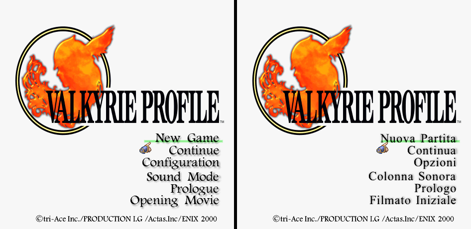

# The title screen menu

The title screen's menu (New Game, Continue, Configuration, Sound Mode, Prologue, Opening Movie, and
Seraphic Gate once the game is finished) looks like text, but it isn't. Each label is a **picture**,
drawn on a sheet and placed by numbers written into the title screen's program code. So it can't be
edited like the rest of the text: it has to be drawn again. This document explains how it works and
how the translation redraws it.



The two files involved are the same on both discs.

## The picture sheet: file 7

File 7 is one compressed stream (SLZ type 2, `docs/SLZ_COMPRESSION.md`) holding a TIM, the
PlayStation's image format:

* **The picture:** 256 × 256 pixels, 4 bits per pixel (16 colours). The game copies it into video
  memory at (896, 256).
* **The palettes:** three palettes of 16 colours, placed in video memory at (16, 504).

The sheet holds every label twice, plus the copyright line:

* **a thin layer:** the letters themselves, smooth-edged;
* **a glow:** a heavier, blurred copy in grey, drawn behind the thin layer to give it its soft halo;
* **the copyright line**, "©tri-Ace Inc./PRODUCTION I.G…", in two pieces.

## The positions: written into the code

File 1 is the title screen's program: one compressed stream of 274,888 bytes, loaded at `0x8002F824`.
Its function `func_80037860` builds the menu's sprites, one item per pass. For each item, a jump table
(at `0x8005103C` for the thin layers, `0x8005105C` for the glows) sends it to a few instructions that
set the sprite's values as constants:

* **size:** width and height, with `lui` and `ori`;
* **position on the sheet:** with `ori` or `addiu`;
* **x on screen:** with `addiu`, added to −8.

The English values:

| item | thin layer | on the sheet | x | right edge |
|---|---|---|---:|---:|
| New Game | 128 × 18 | (0, 128) | 320 − 8 | 440 |
| Continue | 100 × 19 | (0, 146) | 348 − 8 | 440 |
| Configuration | 156 × 24 | (0, 165) | 294 − 8 | 442 |
| Sound Mode | 144 × 20 | (0, 189) | 303 − 8 | 439 |
| Prologue | 96 × 24 | (0, 0) | 351 − 8 | 439 |
| Opening Movie | 180 × 25 | (0, 25) | 269 − 8 | 441 |
| Seraphic Gate | 160 × 25 | (96, 0) | 64 | 224 |

* **Right-aligned:** the labels end at about x 440. Seraphic Gate is the exception: its x is an
  absolute 64.
* **The glow:** each glow sprite goes at its thin label's x and y, one pixel off for some items.
  Configuration, Sound Mode and Seraphic Gate have their glow in two pieces, the second at a fixed
  offset from the first.
* **Prologue:** its sheet position is written as zero (`sh $zero`), not as a constant, so its thin
  label has to stay at (0, 0).

## Redrawing it: `vp_title_menu.py`

`vp_text_editor.py export DISC.cue --title` writes a template edit file, one label per item. From
`edits_it/title_menu.txt`:

```
@@ 0 New Game
Nuova Partita
@@ 1 Continue
Continua
```

The build then redraws the whole menu, so every label matches:

* **Rendering:** each label is drawn with Times New Roman 25 pt for the thin layer, the system serif
  closest to the game's. The glow is Times New Roman Bold 24 pt, blurred twice and merged. This uses
  macOS's text engine through a small Swift program, `tools/render.swift`, so it needs macOS and
  `swiftc`.
* **Packing:** the copyright pieces stay where they are, and the new pieces are packed around them.
  Prologue's thin label goes first, at (0, 0). Three orders are tried (tallest, widest or largest
  first), and the first that fits is used.
* **Patching:** the size, sheet position and x constants in file 1 are rewritten. A thin label's x is
  448 minus its width, so the labels stay right-aligned at 440. Seraphic Gate keeps its right edge.
* **Repacking:** files 7 and 1 are compressed again and written back in place.

**Room.** The sheet is the limit. The English labels use 73 letters, and the Italian ones 79, with
"Colonna Sonora" for Sound Mode. If the labels don't fit, the build says so and asks for shorter ones.

## The Italian menu

The translation's labels (`edits_it/title_menu.txt`, with the choices in `docs/GLOSSARY.md`):

| English | Italian |
|---|---|
| New Game | Nuova Partita |
| Continue | Continua |
| Configuration | Opzioni |
| Sound Mode | Colonna Sonora |
| Prologue | Prologo |
| Opening Movie | Filmato Iniziale |
| Seraphic Gate | Porta Serafica |

**Checked in the emulator.** The menu shows each label with its glow, right-aligned like the
original. The hand cursor and the green selection line are in place, though the line sits one pixel
lower on the text than in the original. Choosing Nuova Partita goes on to the difficulty screen as
before.

The titles at the top of the screens behind the menu (New Game, Continue and so on) are a different
thing: an italic font, explained in `docs/FONTS_AND_GLYPHS.md`.

## Not known yet

* **Porta Serafica on screen:** it only appears once the game is finished, so it hasn't been seen.
* **The game's typeface:** Times New Roman is close, but the original font hasn't been identified.
